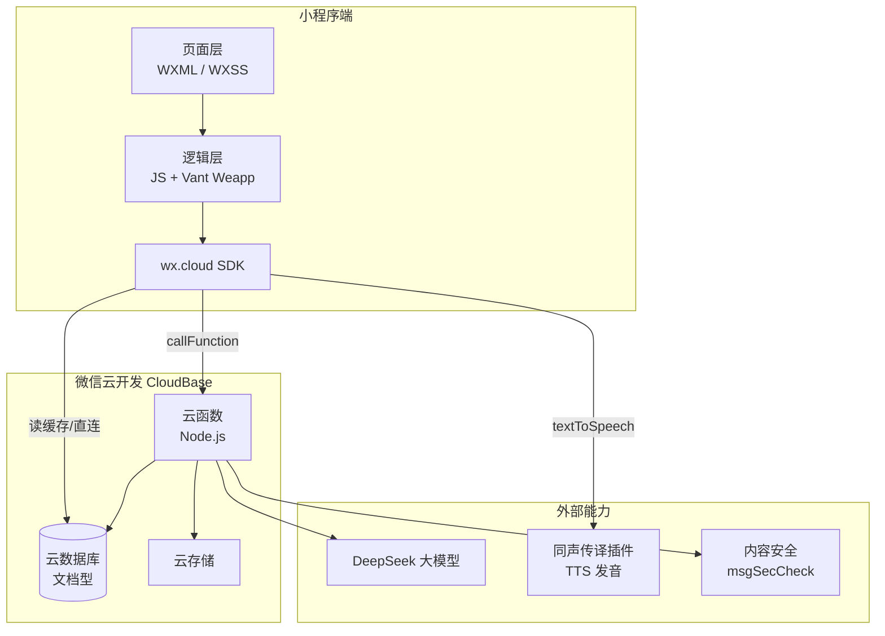
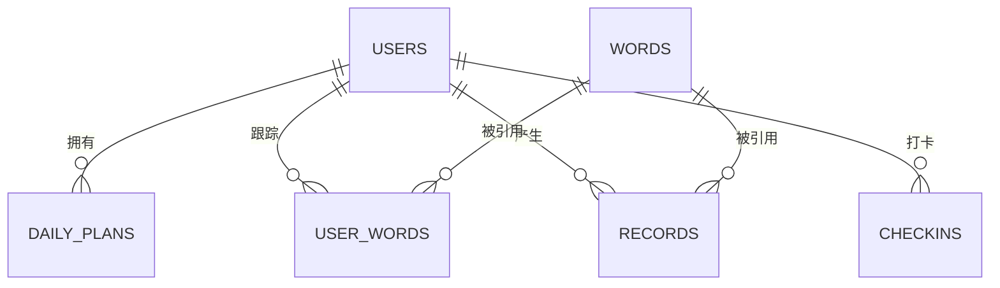
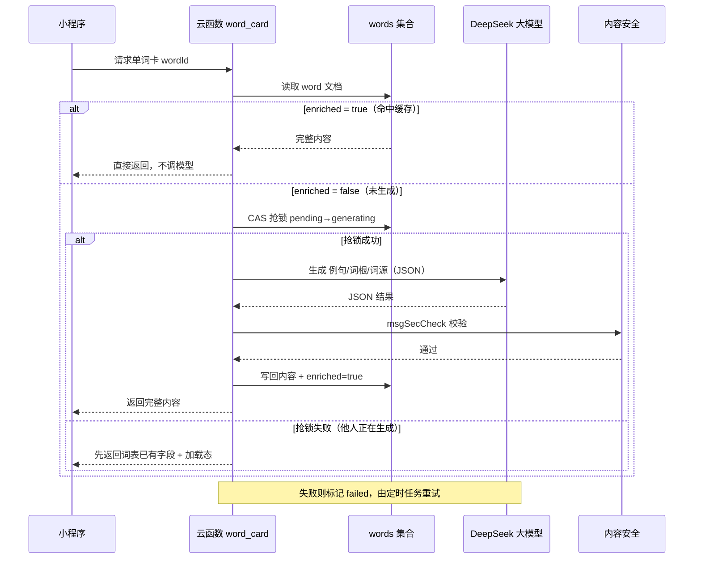
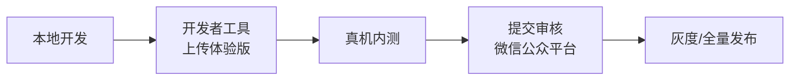

# 雅思词汇微信小程序 — 技术方案设计

> ⚠️ **历史稿，已过时，请勿据此施工。**
> 本文写于设计阶段（2026-09-25），其中**前端 UI 库（Vant Weapp）、发音方案（微信同声传译插件）、部分字段名（如 `questionQueue`）与最终实现不一致**，均以 [`docs/project-spec.md`](../../docs/project-spec.md) 为准。
> 保留本文只为追溯当时的架构取舍（数据模型、AI 缓存、接口设计的原始讨论）。
>
> 现行文档：`docs/project-spec.md`（业务逻辑，以源码为准）、`docs/deploy.md`（部署步骤）。

> 版本：v0.2
> 日期：2026-09-25
> 上游文档：`requirements.md`（v0.3，已确认）
> 技术底座：微信云开发 CloudBase（云函数 + 云数据库 + 云存储）+ DeepSeek 大模型

---

## 1. 架构总览



**分层职责：**

- **小程序端**：负责渲染与交互，不持有任何密钥；只做「读」的直连查询（如已缓存的词条）与云函数调用。
- **云函数**：所有写操作、AI 调用、内容安全、防重复生成的锁逻辑都在服务端完成。
- **云数据库**：既是业务数据存储，也是 **AI 生成内容的缓存层**（`words.enriched`）。
- **外部能力**：大模型只在缓存未命中时被调用；发音走插件，无需域名配置。

---

## 2. 技术选型

| 层 | 选型 | 理由 |
|---|---|---|
| 小程序框架 | **微信小程序原生**（WXML/WXSS/JS） | MVP 零构建链、云开发集成最顺；跨端需求出现后再迁 Taro |
| UI 组件库 | **Vant Weapp** | 弹窗/Toast/表单/选择器开箱即用，少造轮子 |
| 后端 | **微信云开发 CloudBase** | 免服务器、免鉴权、免运维，天然拿 openid |
| 云函数运行时 | Node.js 18 | 生态成熟，AI SDK 齐全 |
| 数据库 | 云开发文档型数据库 | 与云函数同环境，免连接配置 |
| 大模型（D1） | **DeepSeek**（`deepseek-chat` / V3，开启 JSON Output） | 中文词根词源解释质量好、国内直连稳定、单价低；OpenAI 兼容协议，换模型成本低 |
| 发音（D2） | **微信同声传译插件 `WechatSI`（TTS）** | 免费、无需配置 downloadFile 域名；备选：有道 `dictvoice` 接口 |
| AI 生成时机（D3） | **按需生成 + 永久缓存** | 首次有加载态，全局只生成一次，成本最低 |
| 词库（D4） | **开源雅思核心词表**（约 3500–5000 词，含释义/音标） | 快速起量，AI 只补例句/词根/词源 |
| 内容安全 | 云调用 `security.msgSecCheck` | 合规刚需，AI 内容入库前必过 |
| 小程序主体（D5） | 个人主体即可（MVP 无支付） | 后续接支付再升级企业主体 |
| UI 风格（D6） | 简洁专注，主色蓝绿（`#185FA5` / `#1D9E75`） | 学习场景低干扰，语义色遵循小程序规范 |

---

## 3. 数据模型（云数据库集合）



### 3.1 `users` — 用户

| 字段 | 类型 | 说明 |
|---|---|---|
| `_openid` | string | 微信用户唯一标识（主键） |
| `nickname` / `avatarUrl` | string | 可选，未授权则为空 |
| `dailyGoal` | number | 每日目标，`5` 或 `10`，默认 5 |
| `streak` | number | 连续打卡天数 |
| `lastCheckinDate` | string | 最近打卡日 `YYYY-MM-DD` |
| `totalLearned` | number | 累计学习单词数 |
| `createdAt` / `updatedAt` | date | 时间戳 |

**索引：** `_openid`（唯一）

### 3.2 `words` — 词库 + AI 缓存（关键表）

| 字段 | 类型 | 来源 | 说明 |
|---|---|---|---|
| `word` | string | 词表 | 单词，唯一 |
| `phoneticUK` / `phoneticUS` | string | 词表 | 音标 |
| `pos` | string | 词表 | 词性 |
| `meaning` | string | 词表 | 中文释义（主） |
| `example` | object | **AI** | `{ en, cn }` 例句 |
| `roots` | array | **AI** | `[{ part, type, meaning }]` 词根拆解 |
| `etymology` | string | **AI** | 词源演变简述 |
| `level` | number | 词表 | 难度/频次，用于排序出词 |
| `enriched` | boolean | 系统 | 扩展内容是否已补全 |
| `enrichStatus` | string | 系统 | `pending` / `generating` / `ok` / `failed` |
| `enrichLockAt` | date | 系统 | 抢锁时间，用于超时释放 |

**索引：** `word`（唯一）、`enriched`、`level`

### 3.3 `user_words` — 用户单词学习状态（复习调度核心）

| 字段 | 类型 | 说明 |
|---|---|---|
| `_openid` / `wordId` | string | 联合唯一 |
| `status` | string | `learning` / `reviewing` / `mastered` |
| `round` | number | 复习轮次（预留 v2 升级 FSRS） |
| `wrongCount` | number | 累计答错次数 |
| `firstLearnedDate` | string | 首次学习日 |
| `nextReviewDate` | string | 下次复习日（次日 = 学习日 +1） |

**索引：** `_openid + wordId`（联合唯一）、`_openid + nextReviewDate`

### 3.4 `daily_plans` — 每日计划

| 字段 | 类型 | 说明 |
|---|---|---|
| `_openid` / `date` | string | 联合唯一 |
| `reviewWordIds` | array | 当日待复习单词 |
| `newWordIds` | array | 当日新词队列 |
| `stage` | string | `review` / `learning` / `practice` / `done` |
| `learnedIds` | array | 已完成学习的单词 |
| `questionQueue` | array | 已生成的练习题目（含题型） |
| `practiceIndex` | number | 练习进度指针 |

**索引：** `_openid + date`（联合唯一）

### 3.5 `records` — 答题记录

| 字段 | 类型 | 说明 |
|---|---|---|
| `_openid` / `wordId` / `date` | | |
| `phase` | string | `review` / `practice` |
| `questionType` | string | `cn_option`（中选项）/ `en_option`（英选中） |
| `isCorrect` | boolean | 是否答对 |
| `attempts` | number | 作答次数 |

**索引：** `_openid + date`、`_openid + isCorrect`

### 3.6 `checkins` — 打卡记录

| 字段 | 类型 | 说明 |
|---|---|---|
| `_openid` / `date` | string | 联合唯一 |
| `streakAtCheckin` | number | 打卡时的连续天数 |
| `learnedCount` | number | 当日学习词数 |

**索引：** `_openid + date`（联合唯一）

---

## 4. 云函数接口清单

| 云函数 | 入参 | 出参 | 说明 |
|---|---|---|---|
| `user_profile` | `{ action: 'get'\|'setGoal', dailyGoal? }` | 用户信息 | 登录 + 读写计划 |
| `home_summary` | `{}` | 今日进度、streak、统计 | 首页聚合数据 |
| `today_flow` | `{}` | `{ stage, reviewWords, newWords, ... }` | 当日流程状态机 |
| `start_new_words` | `{}` | `newWordIds` | **幂等**生成当日新词队列 |
| `word_card` | `{ wordId }` | 单词卡完整内容 | **含 AI 补全 + 缓存**（核心） |
| `build_questions` | `{ phase, wordIds }` | 题目数组（双向题型） | 生成选择题与干扰项 |
| `submit_answer` | `{ wordId, phase, questionType, choice }` | `{ correct, attempts }` | 判题 + 记录 |
| `finish_checkin` | `{}` | `{ streak, totalLearned }` | 打卡 + 更新 streak |
| `stats` | `{ range }` | 日历/统计 | 统计页数据 |
| `seed_words` | `{ fileId }` | `{ imported }` | 一次性：导入词表（管理用） |
| `enrich_word` | `{ wordId }` | 生成结果 | 内部：AI 补全（可被定时任务重试） |

---

## 5. AI 内容生成与缓存流程（核心设计）



### 5.1 防重复生成（并发控制）

多个用户同时学同一个词时，必须保证只生成一次：

1. 用**乐观锁**抢占：`updateOne({ _id, enrichStatus: 'pending' }, { $set: { enrichStatus: 'generating', enrichLockAt: now } })`
2. 抢到的云函数负责调模型并写回；未抢到的直接返回词表已有字段（前端展示加载态）。
3. **超时释放**：定时任务扫描 `enrichStatus = 'generating'` 且 `enrichLockAt` 超过 60 秒的记录，重置为 `pending` 重试。

### 5.2 Prompt 模板

```
你是雅思词汇教学专家。为单词 "{word}"（词性 {pos}，释义：{meaning}）生成学习卡片内容。
严格返回 JSON，不要多余文字：
{
  "example": { "en": "英文例句(≤20词)", "cn": "中文翻译" },
  "roots": [ { "part": "ab-", "type": "prefix|root|suffix", "meaning": "含义" } ],
  "etymology": "词源演变简述(≤60字)"
}
要求：例句贴近雅思学术/生活场景；词根拆解准确，无词根则返回空数组；词源简明。
```

### 5.3 降级策略

| 场景 | 降级行为 |
|---|---|
| 模型超时/报错 | 返回词表已有字段（单词/音标/释义），其余显示「暂缺」；标记 `failed` 待重试 |
| 内容安全不通过 | 丢弃该字段，不展示，不改 `enriched`，记日志 |
| JSON 解析失败 | 重试 1 次，仍失败则标记 `failed` |
| 发音获取失败 | 轻提示「发音加载失败」，不阻断学习 |

---

## 6. 发音方案

**主方案：微信同声传译插件（`WechatSI`）**

```js
const plugin = requirePlugin('WechatSI')
plugin.textToSpeech({
  lang: 'en_US',
  tts: true,
  content: 'abandon',
  success: (res) => { audio.src = res.filename; audio.play() }
})
```

- 免费、无需配置 `downloadFile` 合法域名
- 需在 `app.json` 声明插件：`"plugins": { "WechatSI": { "version": "0.3.5", "provider": "wx069ba97219f66d99" } }`
- 覆盖：`InnerAudioContext` 单例，重复点击 `stop()` 后再 `play()`

**备选方案：有道词典音频接口**

- 形如 `https://dict.youdao.com/dictvoice?audio=abandon&type=1`（1=英式，2=美式）
- 需在后台配置 `downloadFile` 合法域名；注意第三方接口稳定性与版权风险

---

## 7. 前端结构

### 7.1 页面清单

| 页面 | 路径 | 说明 |
|---|---|---|
| 首页 | `pages/index` | 今日进度、连续打卡、进入学习 |
| 引导设置 | `pages/onboarding` | 首次选择每日 5/10 |
| 学习卡片 | `pages/learn` | 单词卡逐张学习 |
| 练习 | `pages/practice` | 复习 + 当日练习（双向题型） |
| 打卡结果 | `pages/checkin` | 打卡成功、streak 动画 |
| 统计 | `pages/stats` | 打卡日历、累计数据（分包） |
| 错题本 | `pages/wrongbook` | 答错单词集中复习（分包） |
| 我的 | `pages/profile` | 目标设置、统计入口 |

### 7.2 状态管理

- MVP 用**全局 `app.globalData` + 页面 `setData`**，不引入 Redux/MobX
- 当日流程状态（stage/进度）由云函数 `today_flow` 统一下发，前端不本地推断，避免多端不一致

### 7.3 关键交互

- 学习卡切换用 `swiper` 或受控索引，预取下一张卡（提前触发 AI 生成，掩盖延迟）
- 练习页答题即本地判态 + 服务端 `submit_answer` 落库（双保险）

---

## 8. 安全与合规

| 项 | 措施 |
|---|---|
| 密钥 | DeepSeek API Key 仅存 `enrich_word` 云函数环境变量，绝不下发前端；前端包体不得出现任何 `sk-` 字符串 |
| 数据库权限 | 默认「仅创建者可读写」；跨用户只读（如 `words`）用自定义安全规则放开读 |
| 内容安全 | AI 生成内容入库前 `msgSecCheck`；用户昵称同等校验 |
| 备案 | 小程序需完成 ICP 备案后方可发布 |
| 词库版权 | 使用明确开源许可的词表，保留来源声明 |
| 防刷 | 云函数对 `word_card` 生成路径做频率限制 |

---

## 9. 测试策略

| 层级 | 内容 |
|---|---|
| 云函数单测 | `start_new_words` 幂等性、`word_card` 缓存命中、AI 降级分支 |
| 接口联调 | 首次流程、次日复习、跨日边界（`lastCheckinDate` 推进） |
| 真机测试 | iOS / Android 双端发音播放、卡片滑动性能 |
| 异常测试 | 模型超时、内容安全拦截、音频失败、断网 |
| 验收对齐 | 逐条对照 `requirements.md` 的 R1–R10 验收标准 |

---

## 10. 部署与发布



- **云函数部署**：开发者工具中右键「上传并部署：云端安装依赖」
- **词库导入**：一次性运行 `seed_words` 云函数，将词表 JSON 批量写入 `words`
- **定时任务**：配置云函数定时触发器，扫描 `failed` / 锁超时的词条重试补全
- **环境隔离**：开发/生产分环境（云开发多环境）

---

## 11. 成本估算（量级参考）

| 项 | 说明 |
|---|---|
| 云开发 | 基础版按量：数据库读写 + 云函数调用次数，小规模用户量级成本极低 |
| 大模型（DeepSeek） | **一次性成本**：全词库（约 4000 词）× 单次生成（每词约 500 token），合计百万 token 量级，**估算十元以内**；生成后永久缓存，边际成本≈0，以 [DeepSeek 官网定价](https://platform.deepseek.com) 为准 |
| 发音 | 同声传译插件免费 |
| 建议 | 云开发设用量告警；词库可分批生成（如按 `level` 优先级）避免首日集中调用 |

---

## 12. 风险与对策

| 风险 | 影响 | 对策 |
|---|---|---|
| 首次学习 AI 生成有等待 | 体验 | 预取下张卡提前触发；加载态+骨架屏；优先批量预生成高频词 |
| 大模型词源质量不稳定 | 内容 | Prompt 约束 + JSON Output 强约束格式 + 抽样人工校验；质量差换 `deepseek-reasoner` 重跑单条 |
| 同声传译插件停服 | 发音 | 保留有道接口作为降级开关 |
| 词库版权 | 合规 | 选用开源许可词表，保留声明 |
| 云函数冷启动 | 首屏慢 | 关键路径函数常驻/预热 |
| 跨日边界（23:59→00:01） | 逻辑 | 以服务端时间为准，统一用 `YYYY-MM-DD`（GMT+8） |

---

*本文档为 Phase 2 产出。确认后进入 Phase 3「任务拆解」。*
